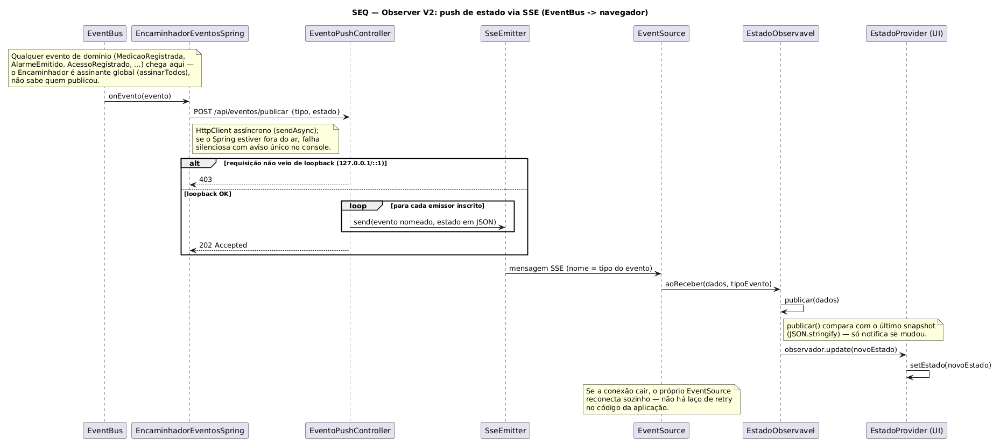
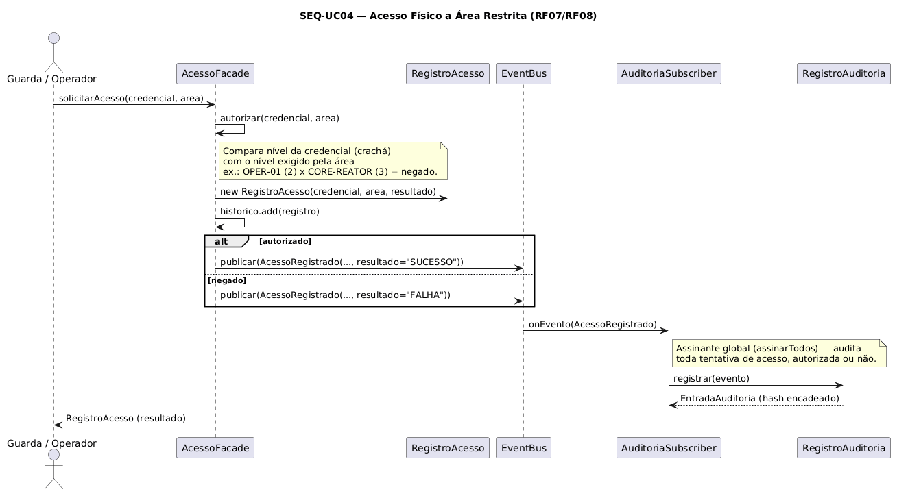

# Diagramas de sequência — pedido do professor (13/11/2026)

O professor gostou da entrega da semana passada (Observer V1/V2) e pediu, para
esta semana, diagramas de sequência entre os objetos. O time já tinha SEQ-UC01
(medição) e SEQ-UC02 (alarme) prontos — ver
[`docs/marco1/07-sequencias-mvp.md`](../marco1/07-sequencias-mvp.md) — então os
dois diagramas novos cobrem fluxos que **ainda não tinham diagrama**: o push de
estado via SSE que acabou de ser entregue, e o acesso físico (UC04/RF08), que
era uma lacuna conhecida.

## Diagrama A — Observer V2: push de estado via SSE

Fonte: [`seq-observer-v2-push.puml`](../marco1/diagramas/seq-observer-v2-push.puml).

Mostra o caminho completo de um evento de domínio até a tela atualizar sozinha,
sem polling: `EventBus` → `EncaminhadorEventosSpring` (ponte mvp→Spring via
HTTP loopback) → `EventoPushController` (`POST /api/eventos/publicar`, espalha
pra cada `SseEmitter` inscrito) → `EventSource` no navegador → `EstadoObservavel`
(só notifica se o dado mudou) → `EstadoProvider` (React re-renderiza).

## Diagrama B — UC04: Acesso físico (RF08)

Fonte: [`seq-uc04-acesso.puml`](../marco1/diagramas/seq-uc04-acesso.puml).

Mostra `AcessoFacade.solicitarAcesso` comparando o nível da credencial com o
nível exigido pela área, registrando o resultado (autorizado ou negado) e
publicando o evento — que a `AuditoriaSubscriber` audita de qualquer jeito,
porque é assinante global e não distingue sucesso de falha. Esse é o ponto
didático do diagrama: toda tentativa de acesso vira registro na trilha, não só
as bem-sucedidas.

## Sobre o Astah

O time mantém o Astah como fonte "bonita" ativa para os diagramas MVP
(`docs/marcus/diagramas/Marcus-UML-MVP.asta`, que já tem os casos de uso +
SEQ-UC01/UC02). Os `.puml` acima seguem a mesma convenção de
"espelho técnico" já usada pelo time (ver `docs/marco1/07-sequencias-mvp.md`) e
têm os participantes e mensagens na ordem exata pra recriar no Astah:

1. Abrir `Marcus-UML-MVP.asta`, duplicar um dos diagramas de sequência
   existentes (SEQ-UC01 ou SEQ-UC02) como ponto de partida de estilo.
2. Diagrama A: 7 lifelines — `EventBus`, `EncaminhadorEventosSpring`,
   `EventoPushController`, `SseEmitter`, `EventSource`, `EstadoObservavel`,
   `EstadoProvider (UI)` — copiar as mensagens na ordem do `.puml` (inclui um
   `alt` pro caso de requisição fora de loopback e um `loop` pra cada emissor
   inscrito).
3. Diagrama B: ator `Guarda / Operador` + 5 lifelines — `AcessoFacade`,
   `RegistroAcesso`, `EventBus`, `AuditoriaSubscriber`, `RegistroAuditoria` —
   com um `alt autorizado/negado` antes de publicar o evento.
4. Exportar como PNG pra dentro de `docs/marcus/diagramas/Marcus-UML-MVP/`,
   seguindo o nome padrão já usado lá (`NN - Descrição.png`).

Os PNGs deste documento foram renderizados a partir do `.puml` pelo servidor
público do PlantUML (sem precisar instalar nada local) — servem como entrega
técnica imediata enquanto a versão Astah não é recriada.
